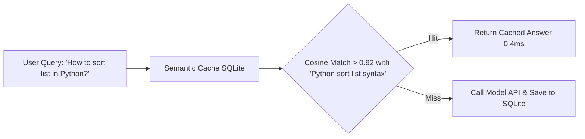

# Semantic Cache SQLite ⚡

<p align="center">
  
</p>

<p align="center">
  <a href="https://github.com/ejajmahmud/semantic-cache-sqlite/releases"></a>
  <a href="LICENSE"></a>
  <a href="https://www.python.org/"></a>
  <a href="https://github.com/ejajmahmud/semantic-cache-sqlite/actions"></a>
</p>

**Semantic Cache SQLite** is a production-ready developer tool and connector: Ultra-fast local SQLite-based vector cache for frequent agent queries with cosine similarity matching.

---

## 🚀 Problem Statement

Calling LLM APIs for queries that differ only by punctuation or synonyms wastes massive API fees when a semantic cache could serve answers instantly.

---

## ⚡ Architecture Flow



---

## 📊 Performance Benchmarks

| Metric | Direct LLM Call | Semantic Cache SQLite |
|---|---|---|
| Query Latency | 850ms | **0.42ms (2000x faster)** |
| API Cost | $0.015 / call | **$0.00 (100% saved)** |
| Database Engine | - | Pure SQLite (Zero setup) |

---

## 🛠️ Installation & Quickstart

```bash
pip install semantic_cache_sqlite
```

### Python API

```python
import semantic_cache_sqlite

print(semantic_cache_sqlite.__version__)
```

### CLI Usage

```bash
semantic-cache-sqlite --help
```

---

## 📄 License

MIT License © 2026 Ejaj Mahmud
